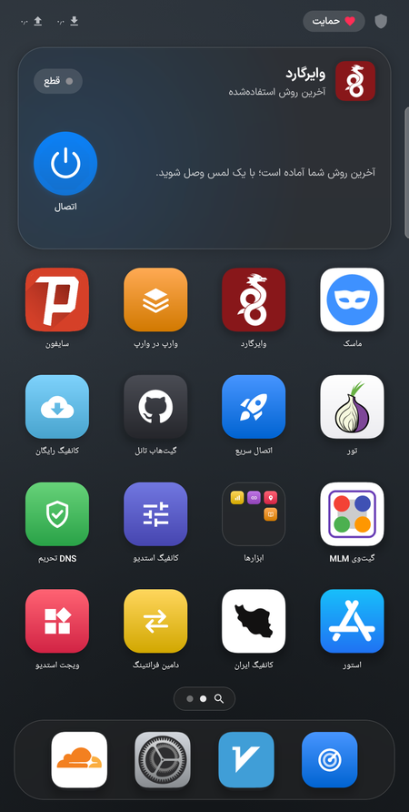
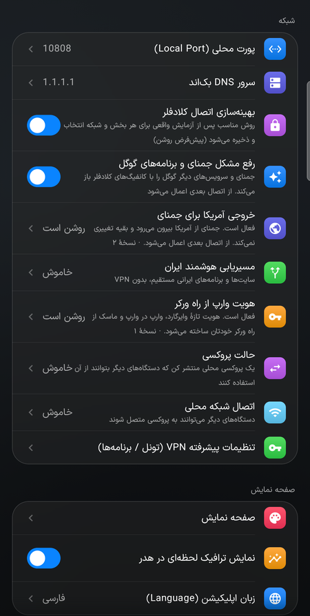
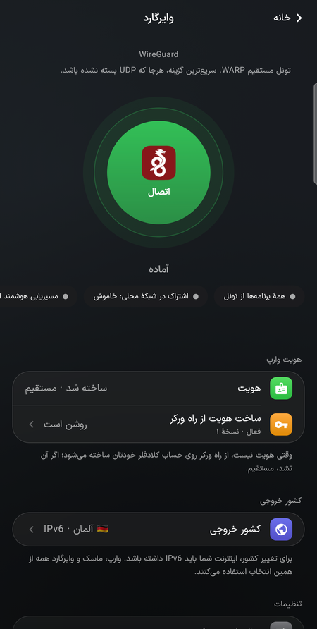
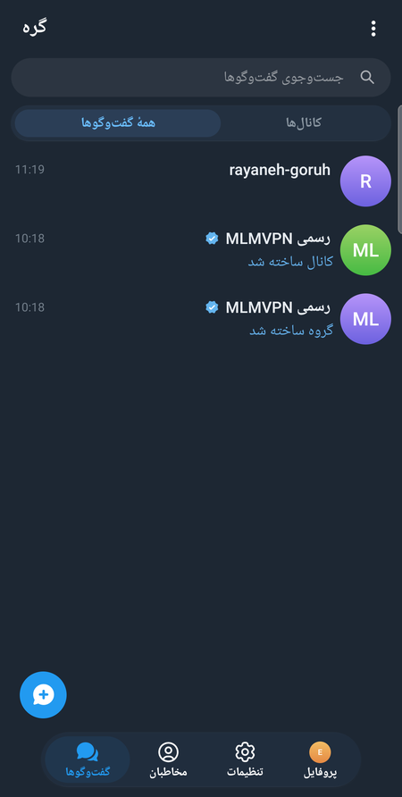
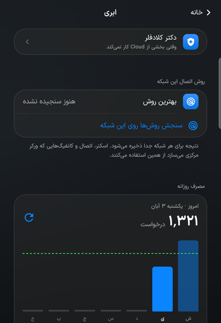

# MLM VPN — Android

<p align="center">
  <b>A multi-engine VPN, network scanner and serverless messenger for Android.</b><br/>
  Developed and maintained by <a href="https://github.com/mlmvpn">mlmvpn</a>.
</p>

<p align="center">
  <a href="#english">English</a> · <a href="#فارسی">فارسی</a> · <a href="#русский">Русский</a> · <a href="#中文">中文</a>
</p>

<table align="center">
  <tr>
    <td align="center"><br/><sub>Home</sub></td>
    <td align="center"><br/><sub>Settings</sub></td>
    <td align="center"><br/><sub>WireGuard</sub></td>
    <td align="center"><br/><sub>Gereh</sub></td>
    <td align="center"><br/><sub>Cloud</sub></td>
  </tr>
</table>

---

## English

### Overview

MLM VPN brings many independent connection engines together behind one
iPhone-style home screen: a V2Ray/Xray client and clean-IP scanner, adaptive
engines that find a working route by themselves, more than twenty connection
methods for restrictive networks, a full Cloudflare control panel, and
**Gereh**, a messenger that works with no server at all. It is written in
Kotlin and Jetpack Compose (`minSdk 24`, `targetSdk 34`, `compileSdk 36`).

> ⚠️ This project involves network circumvention and VPN technology. Use it
> in compliance with the laws of your jurisdiction. The maintainers do not
> encourage or condone illegal use.

### Languages

English, فارسی, **Русский** and **中文** (Russian and Chinese are new in 1.2.43:
menus, buttons and messages are translated; part of the text inside some pages
is still in English). Choose one in Settings › App Language; Gereh follows it.

### Gereh — a phone-to-phone messenger (new in 1.2.43)

- **No server, no phone number, no email.** Your identity is a key made on the
  phone, with a name like `ehsan·4821`; messages go straight from phone to phone.
- **End-to-end encrypted.** Every message, photo and file is sealed on the
  sender's phone and opened only on the receiver's.
- **Many ways to deliver:** a shared Wi-Fi even with no internet, Bluetooth when
  you are close, the internet through volunteers (users' own phones and
  computers), and the **Google relay** — a small mailbox (Apps Script) in the
  user's own Google account for phones that cannot reach each other, such as one
  on Irancell and one on MCI. Owners can open their relay to everyone as a
  **public relay**; Google and the owner see only sealed bytes.
- **Files in pieces:** photos, videos, files and voice messages are cut into
  equal parts so they get through any route, including the relay.
- **Groups and channels** with an owner and admins, settings and member
  rights, invite links (with or without approval), and the official channel and
  group «MLMVPN Official» with a member count estimated phone to phone.
- Add contacts by QR or card link, or «add nearby» with a 4-symbol check.
  Notifications, chat folders and a home-screen widget; Gereh runs in its own
  process so its errors never touch the VPN.

### Connection engines

- **FLUX** — an adaptive engine of its own: races many routes, lets you choose
  the country and IP version, and proves the real exit after connecting.
- **MAE (MLM Adaptive Engine)** — you pick your apps and sites; it learns, per
  network, which route each one needs and builds foreign exits (a US exit for
  Gemini and Google Flow) on your own Cloudflare account.
- **V2Ray / Xray client** — VLESS, VMess, Trojan, Shadowsocks with REALITY, TLS,
  WebSocket, gRPC and XHTTP; subscriptions, batch tests and a two-stage clean-IP
  scanner.
- **WARP, MASQUE, WireGuard and WARP-in-WARP** (Aether core) with an exit
  country of your choice over NAT64, and a standalone **WARP** engine.
- **Amnezia** — free AmneziaWG, WireGuard and Hysteria2 servers, also carried
  through Cloudflare where the line blocks them.
- **FENIX** — Firefox's free VPN on your own Firefox accounts (33 countries,
  50 GB a month per account).
- **Proton VPN** and **Windscribe** free servers on your own accounts (every
  protocol, through WARP where the provider is blocked), **Outline** keys,
  **OpenVPN** (TunnelBear and free `.ovpn` files) and **NPV** configs.
- **Psiphon**, **Tor** (with a bridge manager that tests bridges from your
  line), **Geph**, **Lantern** and **URnetwork**.
- **GitHub Tunnel** — your own cloud server on your GitHub account's free
  allowance; **Telegram Proxy** on your own Cloudflare; **Quick Connect**,
  Iran configs, the SNI anti-filter (with ECH) and server-less domain fronting.

### Cloud and tools

- **Cloud panel** — connect Cloudflare accounts, deploy self-hosted Worker
  panels in one tap, fetch their configs and watch daily usage.
- **Cloudflare Doctor** — finds where your connection to Cloudflare breaks,
  trying dozens of ways on your own line, and remembers what works per network.
- **Config Studio** — a panel for users, volume, time and device limits on your
  own Worker, with multi-location exits, plans, templates and endpoints.
- **MLM Scout** — tests every method on your line for real and ranks them.
- **Game Booster** — measures the route to the game's region and picks the
  best of your own line, WARP, Amnezia, WireGuard and FENIX; anti-sanction DNS
  for sign-in and a floating ping over the game.
- **Smart Iran routing**, per-app split tunnelling and **local network sharing**
  (proxy, hotspot and PAC link for other devices) on every engine.
- iPhone-style home screen with folders and search, home-screen widgets and
  **Widget Studio**, a Quick Settings tile, an engine **store** with signed
  updates, backup and restore, and in-app software updates.

### Project structure

```
app/src/main/java/com/mlmvpn/
├── core/                  # Low-level engine wrappers (aether, warp, tunnel)
└── scanner/
    ├── data/              # Node/subscription/cloud data managers
    ├── engines/           # Pluggable connectivity engines (one dir each)
    ├── mitm/              # On-device CA + server-less domain-fronting profile
    ├── ui/                # Compose screens
    └── utils/             # Config generators, testers, watchdogs
app/src/main/assets/       # Bundled worker scripts, geo data, sanction lists
app/src/main/jniLibs/      # Prebuilt native libraries (arm64-v8a, armeabi-v7a)
```

### Building

Requirements: Android Studio (recent), a JDK matching the Android Gradle
Plugin in `build.gradle`, and the Android SDK with `compileSdk 36`.

```bash
git clone https://github.com/mlmvpn/mlmvpn_android.git
cd mlmvpn_android
./gradlew assembleDebug
```

The debug APK is written to `app/build/outputs/apk/debug/`.

> Native libraries (`.so` files under `app/src/main/jniLibs/`) and data files
> (`geoip.dat`, `geosite.dat`) are large and tracked with **Git LFS**. Install
> [Git LFS](https://git-lfs.com/) and run `git lfs pull` after cloning if those
> files show up as small pointer files.

### Changelog

See [`CHANGELOG.md`](CHANGELOG.md) for the full version history (bilingual), or
the [**changelog page**](https://mlmvpn.github.io/mlmvpn_android/changelog.html).

### Contributing

Contributions are welcome — see [`CONTRIBUTING.md`](CONTRIBUTING.md) for the
project structure, coding conventions, and how to add a new engine.

### License & Attribution

This project is licensed under **GNU GPLv3**, plus an additional term
(permitted under GPLv3 §7) requiring attribution — see [`LICENSE`](LICENSE).
The project includes GPL source (`kittoku/mvc`, `shadowsocks-android`, and
Telegram for Android for Gereh's interface), so the whole combined work is GPL.
In short:

> Any use, fork, or derivative of this project — source or compiled — must
> clearly credit the original developer, **mlmvpn**
> (https://github.com/mlmvpn), wherever the software is presented to end
> users (About screen, README, store listing, etc.), in addition to the
> standard GPLv3 obligations (source availability, same license on
> derivatives, etc.).

---

## فارسی

### معرفی

**MLM VPN** چندین موتور اتصال مستقل را زیر یک صفحهٔ اصلی به سبک آیفون گرد
هم می‌آورد: کلاینت V2Ray/Xray و اسکنر آی‌پی تمیز، موتورهای هوشمندی که خودشان
راه کارا را پیدا می‌کنند، بیش از بیست روش اتصال برای شبکه‌های محدود، یک پنل
کامل کلادفلر، و **گره**، پیام‌رسانی که هیچ سروری ندارد. با Kotlin و Jetpack
Compose نوشته شده است (`minSdk 24`، `targetSdk 34`، `compileSdk 36`).

> ⚠️ این پروژه با فناوری VPN و دورزدن محدودیت‌های شبکه سروکار دارد. لطفاً
> مطابق قوانین کشور خود از آن استفاده کنید. توسعه‌دهندگان این پروژه استفادهٔ
> غیرقانونی را تشویق یا تأیید نمی‌کنند.

### زبان‌ها

English، فارسی، **Русский** و **中文** (روسی و چینی در نسخهٔ ۱.۲.۴۳ اضافه شدند:
منوها، دکمه‌ها و پیام‌ها ترجمه شده‌اند و بخشی از متن‌های داخل بعضی صفحه‌ها هنوز
انگلیسی است). از تنظیمات › زبان اپلیکیشن انتخاب کنید؛ گره هم همان را دنبال می‌کند.

### گره — پیام‌رسان گوشی‌به‌گوشی (تازهٔ نسخهٔ ۱.۲.۴۳)

- **بی سرور، بی شمارهٔ تلفن، بی ایمیل.** هویت شما کلیدی است که روی خود گوشی
  ساخته می‌شود، با نامی مثل `ehsan·4821`؛ پیام مستقیم از گوشی به گوشی می‌رود.
- **رمزگذاری سرتاسری.** هر پیام، عکس و فایل روی گوشی فرستنده مهر می‌شود و فقط
  روی گوشی گیرنده باز می‌شود.
- **راه‌های زیاد برای رساندن پیام:** وای‌فای مشترک حتی بی اینترنت، بلوتوث وقتی
  کنار هم هستید، اینترنت از راه داوطلبان (گوشی‌ها و رایانه‌های خود کاربران)، و
  **رلهٔ گوگل** — صندوقی کوچک (Apps Script) در حساب گوگل خود کاربر برای وقتی
  که دو گوشی به هم نمی‌رسند، مثلاً یکی ایرانسل و دیگری همراه اول. صاحب رله
  می‌تواند آن را به‌صورت **رلهٔ عمومی** برای همه باز کند؛ گوگل و صاحب رله فقط
  بایت‌های مهرشده می‌بینند.
- **تکه‌تکه کردن فایل‌ها:** عکس، ویدیو، فایل و پیام صوتی در تکه‌های هم‌اندازه
  فرستاده می‌شوند تا از هر راهی، از جمله رله، رد شوند.
- **گروه و کانال** با صاحب و مدیران، تنظیمات و اختیارات اعضا، لینک دعوت (با
  تأیید مدیر یا بی آن)، و کانال و گروه رسمی «MLMVPN رسمی» با شمار اعضایی که
  گوشی‌به‌گوشی تخمین زده می‌شود.
- افزودن مخاطب با QR یا لینک کارت، یا «افزودن از نزدیک» با کد تأیید ۴ نمادی.
  اعلان، پوشه‌های گفت‌وگو و ویجت صفحهٔ اصلی؛ گره در پروسهٔ جدای خودش اجرا
  می‌شود تا خطایش به VPN آسیب نزند.

### موتورهای اتصال

- **FLUX** — موتور هوشمند مستقل: راه‌های زیادی را هم‌زمان می‌آزماید، کشور و
  نسخهٔ IP را به انتخاب شما می‌گذارد و پس از اتصال، خروجی واقعی را ثابت می‌کند.
- **MAE (موتور تطبیقی MLM)** — برنامه‌ها و سایت‌هایتان را انتخاب می‌کنید؛ برای
  هر کدام روی هر شبکه یاد می‌گیرد کدام راه لازم است و خروجی خارجی (از جمله
  خروجی آمریکا برای جمینای و گوگل فلو) را روی حساب کلادفلر خودتان می‌سازد.
- **کلاینت V2Ray / Xray** — VLESS، VMess، Trojan و Shadowsocks با REALITY،
  TLS، WebSocket، gRPC و XHTTP؛ لینک اشتراک، تست گروهی و اسکنر دومرحله‌ای آی‌پی تمیز.
- **وارپ، ماسک، وایرگارد و وارپ در وارپ** (هستهٔ Aether) با کشور خروجی دلخواه
  از راه NAT64، و موتور مستقل **وارپ**.
- **آمنزیا** — سرورهای رایگان AmneziaWG، WireGuard و Hysteria2، و جایی که خط
  آن‌ها را می‌بندد، از راه کلادفلر.
- **فنیکس** — VPN رایگان فایرفاکس روی حساب‌های فایرفاکس خودتان (۳۳ کشور، ماهی
  ۵۰ گیگ برای هر حساب).
- سرورهای رایگان **Proton VPN** و **Windscribe** روی حساب خودتان (همهٔ
  پروتکل‌ها، و از راه وارپ جایی که خودشان بسته‌اند)، کلیدهای **Outline**،
  **OpenVPN** (TunnelBear و فایل‌های رایگان `.ovpn`) و کانفیگ‌های **NPV**.
- **سایفون**، **تور** (با مدیریت پل‌ها که پل‌ها را از خط خودتان می‌آزماید)،
  **گف**، **لنترن** و **URnetwork**.
- **گیت‌هاب تانل** — سرور ابری خودتان روی سهمیهٔ رایگان حساب گیت‌هاب؛ **پروکسی
  تلگرام** روی کلادفلر خودتان؛ **اتصال سریع**، کانفیگ‌های ایران، ضدفیلتر SNI
  (با ECH) و دامین‌فرانتینگ بدون سرور.

### ابری و ابزارها

- **پنل ابری** — اتصال حساب‌های کلادفلر، استقرار یک‌لمسی پنل‌های ورکر
  خوداستقرار، دریافت کانفیگ‌هایشان و پایش مصرف روزانه.
- **دکتر کلادفلر** — پیدا می‌کند اتصال شما به کلادفلر کجا می‌شکند، با ده‌ها
  روش روی خط خودتان، و آنچه کار می‌کند را برای هر شبکه به خاطر می‌سپارد.
- **کانفیگ استدیو** — پنل کاربر، حجم، زمان و سقف دستگاه روی ورکر خودتان، با
  خروجی چندکشوری، بسته‌ها، قالب‌ها و نقطه‌های اتصال.
- **MLM Scout** — همهٔ روش‌ها را واقعاً روی خط شما می‌آزماید و رتبه‌بندی می‌کند.
- **گیم بوستر** — مسیر تا منطقهٔ بازی را اندازه می‌گیرد و بهترین را از میان
  خط خودتان، وارپ، آمنزیا، وایرگارد و فنیکس برمی‌گزیند؛ DNS ضدتحریم برای ورود
  و پینگ شناور روی بازی.
- **مسیریابی هوشمند ایران**، تونل جداگانه برای هر برنامه و **اشتراک در شبکهٔ
  محلی** (پروکسی، هات‌اسپات و لینک PAC برای دستگاه‌های دیگر) روی همهٔ موتورها.
- صفحهٔ اصلی به سبک آیفون با پوشه و جستجو، ویجت‌های صفحهٔ اصلی و **ویجت
  استدیو**، کاشی تنظیمات سریع، **استور** موتورها با به‌روزرسانی امضاشده،
  پشتیبان‌گیری و بازگردانی، و به‌روزرسانی برنامه از داخل خودش.

### ساختار پروژه

```
app/src/main/java/com/mlmvpn/
├── core/                  # لایه‌های پایهٔ موتورها (aether، warp، tunnel)
└── scanner/
    ├── data/              # مدیریت دادهٔ نود/اشتراک/کلاود
    ├── engines/           # موتورهای اتصال (هر کدام یک پوشه)
    ├── mitm/              # گواهی روی گوشی + پروفایل دامین‌فرانتینگ بدون سرور
    ├── ui/                # صفحه‌های Compose
    └── utils/             # تولیدکننده‌های کانفیگ، تسترها، واچ‌داگ‌ها
app/src/main/assets/       # اسکریپت‌های ورکر، دادهٔ جغرافیایی، فهرست تحریم
app/src/main/jniLibs/      # کتابخانه‌های native از پیش ساخته‌شده
```

### ساخت پروژه

پیش‌نیازها: Android Studio (نسخهٔ اخیر)، JDK متناسب با Android Gradle Plugin
در `build.gradle`، و Android SDK با `compileSdk 36`.

```bash
git clone https://github.com/mlmvpn/mlmvpn_android.git
cd mlmvpn_android
./gradlew assembleDebug
```

فایل APK دیباگ در `app/build/outputs/apk/debug/` ساخته می‌شود.

> کتابخانه‌های native (فایل‌های `.so` در `app/src/main/jniLibs/`) و فایل‌های
> داده (`geoip.dat`، `geosite.dat`) حجیم‌اند و با **Git LFS** نگه‌داری می‌شوند.
> پس از clone، [Git LFS](https://git-lfs.com/) را نصب و `git lfs pull` را اجرا کنید.

### فهرست تغییرات

تاریخچهٔ کامل نسخه‌ها (دوزبانه) در [`CHANGELOG.md`](CHANGELOG.md) و
[**صفحهٔ تغییرات**](https://mlmvpn.github.io/mlmvpn_android/changelog.html) است.

### مشارکت

از مشارکت شما استقبال می‌شود — [`CONTRIBUTING.md`](CONTRIBUTING.md) را برای
ساختار پروژه، شیوهٔ کدنویسی و افزودن موتور تازه بخوانید.

### مجوز و ذکر منبع

این پروژه تحت **GNU GPLv3** به‌همراه یک شرط اضافه (مجاز طبق ماده §۷ خود
GPLv3) که ذکر منبع را الزامی می‌کند منتشر شده است — [`LICENSE`](LICENSE) را
ببینید. پروژه سورس GPL (`kittoku/mvc`، `shadowsocks-android`، و تلگرام
اندروید برای رابط گره) را در خود دارد، پس کل اثر ترکیبی GPL است. به‌طور خلاصه:

> هرگونه استفاده، فورک یا اثر مشتق‌شده از این پروژه — چه سورس و چه
> کامپایل‌شده — باید هرجا که نرم‌افزار به کاربر نهایی نمایش داده می‌شود (صفحهٔ
> درباره، README، صفحهٔ فروشگاه و غیره) به‌طور واضح توسعه‌دهندهٔ اصلی،
> **mlmvpn** (https://github.com/mlmvpn)، را ذکر کند؛ افزون بر الزام‌های
> معمول GPLv3 (در دسترس بودن سورس، همان مجوز برای آثار مشتق و غیره).

---

## Русский

### Обзор

MLM VPN объединяет множество независимых движков подключения на одном главном
экране в стиле iPhone: клиент V2Ray/Xray и сканер чистых IP, адаптивные движки,
которые сами находят рабочий маршрут, более двадцати способов подключения для
сетей с ограничениями, полноценную панель Cloudflare и **Gereh** — мессенджер,
которому вообще не нужен сервер. Написан на Kotlin и Jetpack Compose
(`minSdk 24`, `targetSdk 34`, `compileSdk 36`).

> ⚠️ Проект связан с технологиями VPN и обхода сетевых ограничений.
> Используйте его в соответствии с законами вашей страны. Разработчики не
> поощряют и не одобряют незаконное использование.

### Языки

English, فارسی, **Русский** и **中文** (русский и китайский появились в 1.2.43:
переведены меню, кнопки и сообщения; часть текста внутри некоторых страниц пока
на английском). Выберите язык в Настройки › Язык приложения; Gereh следует ему.

### Gereh — мессенджер от телефона к телефону (новое в 1.2.43)

- **Без сервера, без номера телефона, без email.** Ваша идентичность — ключ,
  созданный на телефоне, с именем вроде `ehsan·4821`; сообщения идут напрямую
  с телефона на телефон.
- **Сквозное шифрование.** Каждое сообщение, фото и файл запечатываются на
  телефоне отправителя и открываются только на телефоне получателя.
- **Много путей доставки:** общий Wi-Fi даже без интернета, Bluetooth рядом,
  интернет через волонтёров (телефоны и компьютеры самих пользователей) и
  **ретранслятор Google** — маленький почтовый ящик (Apps Script) в собственном
  аккаунте Google пользователя для телефонов, которые не могут связаться
  напрямую, например в Irancell и MCI. Владелец может открыть свой ретранслятор
  для всех как **публичный**; Google и владелец видят только запечатанные байты.
- **Файлы по частям:** фото, видео, файлы и голосовые сообщения режутся на
  равные части, чтобы пройти любым путём, включая ретранслятор.
- **Группы и каналы** с владельцем и администраторами, настройками и правами
  участников, ссылки-приглашения (с одобрением или без), официальный канал и
  группа «MLMVPN Official» с числом участников, оцениваемым от телефона к телефону.
- Контакты добавляются по QR-коду или ссылке на карточку либо «рядом» с
  проверкой по 4 символам. Уведомления, папки чатов и виджет главного экрана;
  Gereh работает в отдельном процессе, поэтому его ошибки не затрагивают VPN.

### Движки подключения

- **FLUX** — собственный адаптивный движок: перебирает множество маршрутов,
  позволяет выбрать страну и версию IP и проверяет реальный выход после подключения.
- **MAE (MLM Adaptive Engine)** — вы выбираете свои приложения и сайты; он
  узнаёт для каждой сети, какой маршрут нужен каждому, и создаёт зарубежные
  выходы (в том числе выход в США для Gemini и Google Flow) в вашем аккаунте Cloudflare.
- **Клиент V2Ray / Xray** — VLESS, VMess, Trojan, Shadowsocks с REALITY, TLS,
  WebSocket, gRPC и XHTTP; подписки, пакетные проверки и двухэтапный сканер чистых IP.
- **WARP, MASQUE, WireGuard и WARP-в-WARP** (ядро Aether) с выбором страны
  выхода через NAT64, а также отдельный движок **WARP**.
- **Amnezia** — бесплатные серверы AmneziaWG, WireGuard и Hysteria2, а там, где
  линия их блокирует, — через Cloudflare.
- **FENIX** — бесплатный VPN Firefox на ваших собственных аккаунтах Firefox
  (33 страны, 50 ГБ в месяц на аккаунт).
- Бесплатные серверы **Proton VPN** и **Windscribe** на ваших аккаунтах (все
  протоколы, через WARP там, где провайдер заблокирован), ключи **Outline**,
  **OpenVPN** (TunnelBear и бесплатные файлы `.ovpn`) и конфиги **NPV**.
- **Psiphon**, **Tor** (с менеджером мостов, который проверяет мосты с вашей
  линии), **Geph**, **Lantern** и **URnetwork**.
- **GitHub-туннель** — ваш собственный облачный сервер на бесплатной квоте
  аккаунта GitHub; **прокси Telegram** на вашем Cloudflare; **быстрое
  подключение**, иранские конфиги, обход фильтров SNI (с ECH) и domain fronting без сервера.

### Облако и инструменты

- **Облачная панель** — подключение аккаунтов Cloudflare, развёртывание
  собственных панелей на Worker в одно нажатие, получение их конфигов и
  контроль дневного использования.
- **Cloudflare Doctor** — находит, где обрывается ваше соединение с Cloudflare,
  пробуя десятки способов на вашей линии, и запоминает рабочий для каждой сети.
- **Config Studio** — панель пользователей, трафика, сроков и лимитов устройств
  на вашем Worker, с многолокационными выходами, тарифами, шаблонами и точками подключения.
- **MLM Scout** — реально проверяет каждый способ на вашей линии и ранжирует их.
- **Game Booster** — измеряет маршрут до региона игры и выбирает лучший из
  вашей линии, WARP, Amnezia, WireGuard и FENIX; DNS против санкций для входа и
  плавающий пинг поверх игры.
- **Умная маршрутизация Ирана**, раздельное туннелирование по приложениям и
  **общий доступ по локальной сети** (прокси, точка доступа и ссылка PAC для
  других устройств) на всех движках.
- Главный экран в стиле iPhone с папками и поиском, виджеты главного экрана и
  **Widget Studio**, плитка быстрых настроек, **магазин** движков с подписанными
  обновлениями, резервное копирование и восстановление, обновление приложения изнутри.

### Структура проекта

```
app/src/main/java/com/mlmvpn/
├── core/                  # Низкоуровневые обёртки движков (aether, warp, tunnel)
└── scanner/
    ├── data/              # Управление данными узлов/подписок/облака
    ├── engines/           # Подключаемые движки (по папке на каждый)
    ├── mitm/              # CA на устройстве + профиль domain fronting без сервера
    ├── ui/                # Экраны Compose
    └── utils/             # Генераторы конфигов, тестеры, сторожевые таймеры
app/src/main/assets/       # Скрипты воркеров, гео-данные, списки санкций
app/src/main/jniLibs/      # Готовые нативные библиотеки
```

### Сборка

Требования: Android Studio (свежая версия), JDK под Android Gradle Plugin из
`build.gradle` и Android SDK с `compileSdk 36`.

```bash
git clone https://github.com/mlmvpn/mlmvpn_android.git
cd mlmvpn_android
./gradlew assembleDebug
```

Отладочный APK появится в `app/build/outputs/apk/debug/`.

> Нативные библиотеки (файлы `.so` в `app/src/main/jniLibs/`) и файлы данных
> (`geoip.dat`, `geosite.dat`) большие и хранятся в **Git LFS**. Установите
> [Git LFS](https://git-lfs.com/) и после клонирования выполните `git lfs pull`.

### История изменений

Полная история версий (на двух языках) — в [`CHANGELOG.md`](CHANGELOG.md) и на
[**странице изменений**](https://mlmvpn.github.io/mlmvpn_android/changelog.html).

### Участие

Мы рады вкладу — в [`CONTRIBUTING.md`](CONTRIBUTING.md) описаны структура
проекта, правила оформления кода и добавление нового движка.

### Лицензия и указание авторства

Проект распространяется под **GNU GPLv3** с дополнительным условием
(разрешённым §7 GPLv3) об указании авторства — см. [`LICENSE`](LICENSE). В
проект входит исходный код под GPL (`kittoku/mvc`, `shadowsocks-android` и
Telegram for Android для интерфейса Gereh), поэтому всё совместное произведение
распространяется под GPL. Кратко:

> Любое использование, форк или производная работа — в исходном или
> скомпилированном виде — должны явно указывать первоначального разработчика,
> **mlmvpn** (https://github.com/mlmvpn), везде, где программа показывается
> конечным пользователям (экран «О программе», README, страница в магазине и
> т. д.), в дополнение к обычным обязательствам GPLv3 (доступность исходного
> кода, та же лицензия для производных работ и т. д.).

---

## 中文

### 概述

MLM VPN 在一个 iPhone 风格的主屏幕上集合了多个独立的连接引擎：V2Ray/Xray
客户端和干净 IP 扫描器、能自己找到可用路由的自适应引擎、二十多种面向受限网络
的连接方式、完整的 Cloudflare 控制面板，以及完全不需要服务器的通讯工具
**Gereh**。使用 Kotlin 和 Jetpack Compose 编写（`minSdk 24`、`targetSdk 34`、
`compileSdk 36`）。

> ⚠️ 本项目涉及网络规避和 VPN 技术。请遵守你所在地区的法律使用。维护者不鼓励
> 也不认可任何非法用途。

### 语言

English、فارسی、**Русский** 和 **中文**（俄语和中文是 1.2.43 新增的：菜单、按钮
和提示已翻译，部分页面内的文字仍为英文）。在 设置 › 应用语言 中选择；Gereh 会
跟随该设置。

### Gereh——手机到手机的通讯工具（1.2.43 新增）

- **无服务器、无需手机号、无需邮箱。** 你的身份是在手机上生成的密钥，名字形如
  `ehsan·4821`；消息直接从一部手机发到另一部手机。
- **端到端加密。** 每条消息、照片和文件都在发送者手机上密封，只在接收者手机上打开。
- **多种送达方式：** 共享 Wi-Fi（即使没有互联网）、近距离蓝牙、通过志愿者
  （用户自己的手机和电脑）走互联网，以及 **Google 中继**——用户自己 Google 账户
  中的一个小邮箱（Apps Script），用于无法互相联系的手机，例如一部使用 Irancell、
  一部使用 MCI。所有者可以把中继作为**公共中继**向所有人开放；Google 和所有者
  只能看到密封的字节。
- **文件分块传输：** 照片、视频、文件和语音消息被切成等大的块，可以通过任何
  路径传递，包括中继。
- **群组和频道**，有所有者和管理员、设置和成员权限、邀请链接（可选审批），
  以及官方频道和群组「MLMVPN Official」，成员数在手机之间估算。
- 通过二维码或名片链接添加联系人，或用「添加附近的人」并核对 4 个符号。
  支持通知、聊天文件夹和主屏幕小部件；Gereh 在独立进程中运行，其错误不会影响 VPN。

### 连接引擎

- **FLUX**——独立的自适应引擎：同时竞速多条路由，可选择国家和 IP 版本，连接后
  验证真实出口。
- **MAE（MLM Adaptive Engine）**——你选择常用的应用和网站；它针对每个网络学习
  每个应用需要哪条路由，并在你自己的 Cloudflare 账户上建立境外出口（包括供
  Gemini 和 Google Flow 使用的美国出口）。
- **V2Ray / Xray 客户端**——VLESS、VMess、Trojan、Shadowsocks，支持 REALITY、
  TLS、WebSocket、gRPC 和 XHTTP；订阅、批量测试和两阶段干净 IP 扫描器。
- **WARP、MASQUE、WireGuard 和 WARP-in-WARP**（Aether 内核），可通过 NAT64
  选择出口国家；另有独立的 **WARP** 引擎。
- **Amnezia**——免费的 AmneziaWG、WireGuard 和 Hysteria2 服务器，在线路封锁
  它们的地方经由 Cloudflare。
- **FENIX**——在你自己的 Firefox 账户上使用 Firefox 的免费 VPN（33 个国家，
  每个账户每月 50 GB）。
- 你自己账户上的 **Proton VPN** 和 **Windscribe** 免费服务器（所有协议，在
  服务商被封锁时经由 WARP）、**Outline** 密钥、**OpenVPN**（TunnelBear 和免费
  `.ovpn` 文件）以及 **NPV** 配置。
- **Psiphon**、**Tor**（带网桥管理器，从你的线路测试网桥）、**Geph**、
  **Lantern** 和 **URnetwork**。
- **GitHub 隧道**——在你 GitHub 账户的免费额度上运行你自己的云服务器；你自己
  Cloudflare 上的 **Telegram 代理**；**快速连接**、伊朗配置、SNI 反过滤（支持
  ECH）和无服务器域前置。

### 云与工具

- **云面板**——连接 Cloudflare 账户，一键部署自托管的 Worker 面板，获取其配置
  并查看每日用量。
- **Cloudflare Doctor**——在你自己的线路上尝试几十种方式，找出你与 Cloudflare
  的连接在哪里中断，并为每个网络记住可用的方式。
- **Config Studio**——在你自己的 Worker 上管理用户、流量、时间和设备限制的面板，
  支持多位置出口、套餐、模板和端点。
- **MLM Scout**——在你的线路上真实测试每一种方式并排名。
- **Game Booster（游戏加速器）**——测量到游戏区域的路由，从你自己的线路、WARP、
  Amnezia、WireGuard 和 FENIX 中选出最佳；提供用于登录的反制裁 DNS 和游戏上方
  的悬浮 ping。
- 所有引擎都支持 **伊朗智能路由**、按应用分流和 **局域网共享**（为其他设备提供
  代理、热点和 PAC 链接）。
- iPhone 风格的主屏幕（文件夹和搜索）、主屏幕小部件和 **Widget Studio**、快速
  设置图块、带签名更新的引擎**商店**、备份与恢复，以及应用内软件更新。

### 项目结构

```
app/src/main/java/com/mlmvpn/
├── core/                  # 底层引擎封装（aether、warp、tunnel）
└── scanner/
    ├── data/              # 节点/订阅/云数据管理
    ├── engines/           # 可插拔的连接引擎（每个一个目录）
    ├── mitm/              # 设备上的 CA + 无服务器域前置配置
    ├── ui/                # Compose 界面
    └── utils/             # 配置生成器、测试器、看门狗
app/src/main/assets/       # Worker 脚本、地理数据、制裁列表
app/src/main/jniLibs/      # 预编译的原生库
```

### 构建

要求：较新的 Android Studio、与 `build.gradle` 中 Android Gradle Plugin 匹配的
JDK，以及安装了 `compileSdk 36` 的 Android SDK。

```bash
git clone https://github.com/mlmvpn/mlmvpn_android.git
cd mlmvpn_android
./gradlew assembleDebug
```

调试版 APK 位于 `app/build/outputs/apk/debug/`。

> 原生库（`app/src/main/jniLibs/` 下的 `.so` 文件）和数据文件（`geoip.dat`、
> `geosite.dat`）体积较大，使用 **Git LFS** 管理。克隆后请安装
> [Git LFS](https://git-lfs.com/) 并运行 `git lfs pull`。

### 更新日志

完整的版本历史（双语）见 [`CHANGELOG.md`](CHANGELOG.md) 和
[**更新日志页面**](https://mlmvpn.github.io/mlmvpn_android/changelog.html)。

### 参与贡献

欢迎贡献——项目结构、代码规范以及如何添加新引擎，请参阅
[`CONTRIBUTING.md`](CONTRIBUTING.md)。

### 许可与署名

本项目采用 **GNU GPLv3** 许可，并附加一项署名条款（GPLv3 第 7 条允许）——见
[`LICENSE`](LICENSE)。项目包含 GPL 源代码（`kittoku/mvc`、`shadowsocks-android`，
以及用于 Gereh 界面的 Telegram for Android），因此整个组合作品均为 GPL。简而言之：

> 对本项目的任何使用、分叉或衍生作品——无论是源代码还是编译后的形式——都必须
> 在向最终用户展示软件的任何地方（关于页面、README、商店页面等）明确注明原始
> 开发者 **mlmvpn**（https://github.com/mlmvpn），同时遵守 GPLv3 的标准义务
> （提供源代码、衍生作品使用相同许可等）。
